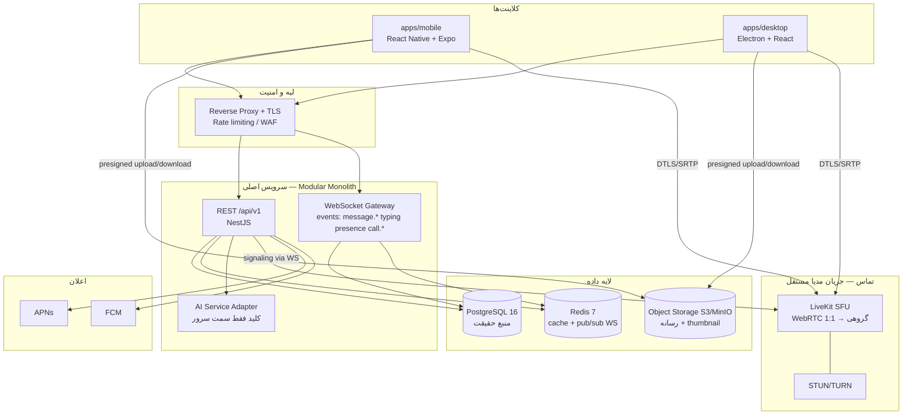
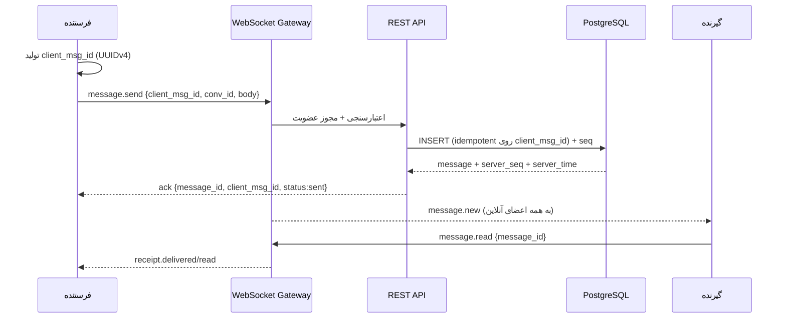

# سند ۰۲ — معماری پیشنهادی

> **نسخه:** v0.1 · این سند تصمیم‌های معماری و استدلال آن‌ها را مستند می‌کند؛ هر تصمیم جایگزین‌هایش را هم فهرست می‌کند تا بعداً قابل بازبینی باشد (ADR-موثق).

## ۱. نمای کلی



چهار نکته معماری که کل سیستم را می‌بندد:

1. **کلاینت‌ها لاغر هستند**؛ منطق مجوز، امنیت و اعتبارسنجی فقط سرور اجرا می‌شود (validation مشترک برای UX است، نه امنیت).
2. **مدیا هرگز از API عبور نمی‌کند** — کلاینت با Presigned URL مستقیم به S3 آپلود/دانلود می‌کند؛ API فقط متادیتا و امضا صادر می‌کند.
3. **مدیای تماس از signaling جدا است** — signaling از WS سرور می‌آید و بایت‌های مدیا مستقیماً به SFU می‌روند؛ این جداسازی مقیاس تماس را مستقل از مقیاس API می‌کند.
4. **همه چیز idempotent و cursor-based** — پیام‌ها با `client_msg_id` و همگام‌سازی با `sync_cursor` تا قطع شبکه هیچ اثر جانبی نگذارد.

## ۲. چرا Modular Monolith؟

انتظار بار نسخه اول (۱۰هزار کاربر هم‌زمان) به‌خوبی با یک سرویس NestJS مقیاس‌افقی‌شده + PostgreSQL + Redis پاسخ می‌دهد. میکروسرویس زودهنگام یعنی: هزینه DevOps چندبرابر، تراکنش‌های توزیع‌شده برای چیزی که با یک ترانزاکس DB حل می‌شود، و کندی چشمگیر سرعت توسعه تیم کوچک. ماژول‌های NestJS با مرزهای روشن (auth, users, conversations, messages, media, calls, notifications, ai, moderation, admin) طوری نوشته می‌شوند که بعداً اگر مقیاس توجیه کرد، جدا کردن `media` یا `calls` ارزان باشد.

**قانون تفکیک:** ماژول‌ها فقط از طریق سرویس‌های عمومی خود با هم حرف می‌زنند (نه دسترسی مستقیم به جدول‌های ماژول دیگر) — این همان چیزی است که تفکیک آینده را ممکن می‌کند.

## ۳. تصمیم‌های فنی کلیدی (با جایگزین‌ها)

### 3.1 موبایل — React Native + Expo ✅

| گزینه | مزایا | معایب |
|---|---|---|
| **React Native + Expo** ✅ | اکوسیستم بزرگ، اشتراک TS/منطق با بک‌اند NestJS، dev builds با ماژول نیتیو، EAS برای بیلد/آپدیت، استخدام‌پذیری بالا | WebRTC نیازمند کتابخانه third-party نگه‌داری‌شده؛ عملکرد انیمیشن‌های سنگین پایین‌تر از نیتیو |
| Flutter | عملکرد رندر یکنواخت، ابزار قوی | Dart (بدون اشتراک کد با پشته TS)، WebRTC/پوش نیازمند پلاگین‌های جامعه‌ای، استخدام دشوارتر در ایران |
| نیتیو دوتایی (Swift/Kotlin) | بهترین تجربه بومی | دو تیم موازی؛ هزینه ۲–۳ برابر؛ همگام‌سازی منطق سخت |

**انتخاب:** RN+Expo. کلاینت‌ها فرم-محور و شبکه‌محورند نه رندر-سنگین؛ و هم‌پوشانی TypeScript با NestJS/پکیج‌های مشترک هزینه کل چرخه را پایین می‌آورد. ریسک WebRTC با انتخاب `react-native-webrtc` (نگه‌داری فعال) و پروتوتایپ زودهنگام تماس در فاز ۵ مهار می‌شود.

### 3.2 دسکتاپ — Electron + React ✅

| گزینه | مزایا | معایب |
|---|---|---|
| **Electron** ✅ | WebRTC/mediadevices کامل، اکوسیستم تست‌شده (auto-update، code signing)، یکی بودن UI با design-system وب | حافظه بیشتر (Chromium جاسازی‌شده) |
| Tauri | باینری کوچک و مصرف حافظه کم | WebRTC در WebView هر OS ناهمگن (WKWebView/WebView2) → ریسک جدی کیفیت تماس؛ اکوسیستم جوان‌تر |
| نیتیو (Swift/WinUI) | تجربه بومی کامل | دو پشته موازی برای دسکتاپ؛ هزینه بالا |

**انتخاب:** Electron. عامل تعیین‌کننده، کیفیت تماس و اشتراک صفحه است که در Chromium همگن است. حافظه اضافی در رایانه‌های دسکتاپ امروزی قابل قبول است.

### 3.3 بک‌اند — NestJS (TypeScript) ✅

| گزینه | مزایا | معایب |
|---|---|---|
| **NestJS** ✅ | ساختار ماژول/DI رسمی، WebSocket Gateway داخلی، یکپارچگی کامل با پکیج‌های مشترک TS، документپذیری خوب | عملکرد خام پایین‌تر از Go؛ وابسته به اکوسیستم Node |
| Fastify خام | سبک و سریع | ساختار ماژولار/دی را باید خودتان بسازید؛ ریسک بی‌نظمی در تیم بزرگ‌شونده |
| Go (Fiber/gin) | عملکرد و همزمانی عالی | شکستن اشتراک تایپ/اعتبارسنجی با کلاینت‌ها؛ استخدام + دو پشته |

**انتخاب:** NestJS. گلوگاه واقعی v1، شبکه و DB است نه CPU؛ صرفه اشتراک کد و سرعت توسعه از سرعت خام مهم‌تر است. اگر روزی ماژول داغی (مثل transform رسانه) ظاهر شد، همان ماژول جدا و در Go بازنویسی می‌شود.

### 3.4 داده — PostgreSQL 16 + Redis 7 ✅

- **PostgreSQL** منبع حقیقت است: تراکنش ACID برای پیام/عضویت/مجوز، `jsonb` برای متادیتا، full-text search داخلی برای v1، و extensionهای بالغ. جایگزین‌ها (MongoDB برای «چت راحت است»!) تراکنش چندرکدانی عضویت/مجوز را تضعیف می‌کنند و مدل رابطه‌ای ما را بازسازی می‌کنند.
- **Redis** برای pub/sub بین نمونه‌های WebSocket، cache presence، نرخ‌محدودی و صف کارهای سبک. هیچ داده دائمی حساسی در Redis نمی‌ماند (TTL کوتاه).

### 3.5 تماس — WebRTC + LiveKit (self-host) ✅

| گزینه | مزایا | معایب |
|---|---|---|
| **LiveKit self-host** ✅ | SFU بالغ، SDK رسمی برای RN/Electron/سرور، room API کامل، مجوز آپاچی-۲ | زیرساخت مجزا (CPU/پهنای‌باند) |
| mediasoup | عملکرد خام عالی، کنترل کامل | لایه‌ای (lib در سطح پایین) — ساخت signaling/room خودتان؛ زمان توسعه چند برابر |
| P2P خالص (mesh) | بدون زیرساخت | فقط تا ۳–۴ نفر عملی؛ کیفیت در موبایل ناپایدار |

**انتخاب:** LiveKit. مسیر ۱:۱ → گروهی بدون بازنویسی signaling؛ STUN/TURN با coturn استقرار می‌یابد و TURN با احراز هویت زمانی (HMAC) محافظت می‌شود.

### 3.6 رسانه — Object Storage سازگار S3 (MinIO dev / S3 یا R2 تولید) ✅

آپلود با **presigned URL** + برای فایل‌های بزرگ multipart upload با ازسرگیری. thumbnail با صف کار سمت سرور (sharp) تولید می‌شود. lifecycle policy برای حذف نهایی پس از نگهداری منطقی. دسترسی همیشه از طریق URLهای امضاشده کوتاه‌عمر — هیچ bucket عمومی.

### 3.7 E2EE — فقط چت خصوصی، فاز ۶ (Signal Protocol)

پروتکل Signal (X3DH + Double Ratchet) با کتابخانه معتبر برای چت خصوصی ۱:۱. چالش‌های طراحی (چنددستگاهی، بازیابی حساب، هماهنگی با اعلان) در سند ۰۶ تفصیل یافته است. گروه‌ها در v1 رمزگذاری در انتقال + رمزگذاری در سکون (disk encryption) دارند و صادقانه «E2EE» نامیده نمی‌شوند.

## ۴. جریان‌های کلیدی (Key Flows)

### 4.1 ارسال پیام (مسیر سعادت)



- اگر ack نرسید، کلاینت **همان `client_msg_id`** را دوباره می‌فرستد؛ سرور idempotent رفتار می‌کند و پیام تکراری نساخته می‌شود.
- ترتیب نهایی با `server_seq` (sequence per conversation) برقرار می‌شود، نه ساعت کلاینت.

### 4.2 آپلود رسانه

`POST /media/presign` → دریافت آدرس‌های signed-part → آپلود مستقیم به S3 (با ازسرگیری multipart) → `POST /media/complete` → صف thumbnail → انتشار پیام با `attachment_id`. حداکثر حجم/نوع در سرور اعتبارسنجی می‌شود (magic bytes، نه فقط extension).

### 4.3 همگام‌سازی دستگاه

هر عضویت گفت‌وگو یک `last_read_seq` و هر دستگاه یک `sync_cursor` دارد. دستگاه تازه وارد با `GET /sync?cursor=...` همه تغییرات پس از کرسر را در دسته‌ها می‌گیرد (پیام/واکنش/receipt/عضویت). این مدل خطای شبکه را به «تکرار امن» تبدیل می‌کند.

## ۵. نمودار استقرار (خلاصه)

```
[Clients] --TLS--> [Reverse Proxy/Caddy]
                       ├─ /api    → [NestJS API ×N (stateless)]
                       ├─ /ws     → [NestJS WS Gateway ×N] --pub/sub--> [Redis]
                       └─ /sfu    → [LiveKit + coturn]
[NestJS] --> [PostgreSQL primary (+replica read در صورت نیاز)]
[NestJS] --> [MinIO/S3]   [صف‌ها در Redis]   [APNs/FCM]   [AI Provider]
```
