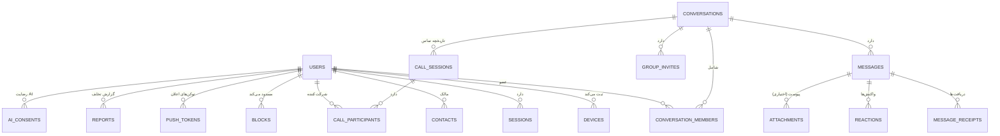

# سند ۰۴ — مدل داده

> **نسخه:** v0.1 · PostgreSQL 16 · همه زمان‌ها UTC با `timestamptz` و از **زمان سرور** ثبت می‌شوند (ساعت کلاینت هرگز مبنای ترتیب نیست).

## ۱. استراتژی‌های پایه

- **شناسه‌ها:** `UUIDv7` (زمان‌محور) برای همه موجودیت‌ها — مرتب‌سازی طبیعی بر اساس زمان، ایندکس‌پذیری بهتر از UUIDv4 در B-tree، و ساخت در کلاینت/سرور بدون تداخل. کلیدهای عضویت/نقش ترکیبی با `(conversation_id, user_id)`.
- **ترتیب پیام:** ستون `server_seq` از نوع `BIGINT` به‌صورت sequence در هر گفت‌وگو (`conversation_seq`) — ترتیب پایدار و صفحه‌بندی cursor.
- **حذف نرم:** `deleted_at` برای پیام/رسانه/گفت‌وگو؛ حذف فیزیکی فقط با jobهای نگهداری.
- **Idempotency:** یگانگی `(conversation_id, client_msg_id)` در `messages` — پایه ضدتکرار ارسال مجدد.
- **صفحه‌بندی:** فقط cursor (`(server_seq)` یا `(created_at,id)`) — offset برای داده متغیر ممنوع.
- **زبان:** نام جدول/ستون انگلیسی snake_case؛ محتوای کاربر فارسی/هر زبانی (UTF-8).

## ۲. ERD سطح دامنه

## ۳. اسکیمای جدول‌های کلیدی

### 3.1 `users`

| ستون | نوع | توضیح |
|---|---|---|
| id | uuid (v7) PK | هویت ثابت و مستقل از شماره/دستگاه |
| phone / email | text، یگانه (یکی اجباری) | شناسه ورود؛ تغییر شماره اینجا آپدیت می‌شود |
| username | text یگانه nullable | نام کاربری عمومی اختیاری |
| display_name | text | نام نمایشی |
| avatar_media_id | uuid → attachments | تصویر پروفایل |
| presence_mode | enum(auto, hidden) | رعایت حریم خصوصی وضعیت |
| ai_default_opt_in | boolean default false | رضایت پیش‌فرض AI |
| status | enum(active, disabled, deletion_pending) | چرخه عمر حساب |
| created_at / updated_at | timestamptz | |

ایندکس‌ها: unique(phone), unique(email), unique(username)؛ search روی display_name (pg_trgm).

### 3.2 `devices` و `sessions`

`devices`: id PK, user_id FK, platform enum(ios,android,windows,macos), device_name, push_token_ref, app_version, last_seen_at, created_at — چنددستگاهی واقعی، هر دستگاه هویت خودش.
`sessions`: id PK, user_id, device_id FK, refresh_hash (هش توکن رفرش، نه خودش), issued_at, expires_at, revoked_at, revoked_reason — چرخش refresh با کشف استفاده مجدد (اگر refresh مصرف‌شده دوباره آمد → ابطال کل زنجیره + رویداد امنیتی).

### 3.3 `conversations` (خصوصی و گروهی یکسان‌مدل)

| ستون | نوع | توضیح |
|---|---|---|
| id | uuid PK | |
| type | enum(private, group) | |
| title / description | text nullable | فقط گروه |
| avatar_media_id | uuid nullable | |
| owner_id | uuid → users | مدیر اصلی گروه |
| settings | jsonb | مجوزها: who_can_add_member, who_can_edit_info ... |
| invite_code | text nullable یگانه | لینک دعوت فعال |
| last_msg_seq | bigint | برای فهرست گفت‌وگوها |
| created_at / archived_at / deleted_at | | |

گفت‌وگوی خصوصی: یگانگی روی `type=private` با جفت اعضا (جدول کمکی unique pair) تا دوبله نشود.

### 3.4 `conversation_members`

| ستون | نوع | توضیح |
|---|---|---|
| conversation_id + user_id | PK ترکیبی | |
| role | enum(owner, admin, member) | |
| joined_at / left_at | | تاریخچه عضویت |
| notification_mode | enum(all, mentions, mute) | تنظیم اعلان هر عضو |
| last_read_seq | bigint | پایه شمارنده خوانده‌نشده |
| pinned | boolean | سنجاق گفت‌وگو |
| blocked_by_admin | boolean | عضو مسدودشده گروه |

### 3.5 `messages`

| ستون | نوع | توضیح |
|---|---|---|
| id | uuid PK | |
| conversation_id | FK | |
| server_seq | bigint | sequence هر گفت‌وگو؛ یگانه در گفت‌وگو |
| sender_id | FK | |
| client_msg_id | text | یگانه با گفت‌وگو (ضدتکرار) |
| type | enum(text, media, system, call_event) | |
| body | text | متن (حداکثر ۴۰۹۶ کاراکتر) |
| reply_to_id | uuid nullable → messages | پاسخ/نقل‌قول |
| edited_at | nullable | ویرایش |
| deleted_at | nullable | حذف نرم (tombstone) |
| created_at | timestamptz | زمان سرور |

ایندکس‌ها: `(conversation_id, server_seq DESC)` اصلی؛ `(conversation_id, client_msg_id)` یگانه؛ FTS روی body (فارسی: `simple`/سفارشی) برای جست‌وجوی v1.

### 3.6 `message_receipts`، `reactions`

- receipts: `(message_id, user_id)` PK؛ delivered_at, read_at — وضعیت sent/delivered/read بدون رشد بی‌رویه (فقط آخرین وضعیت نگه می‌شود).
- reactions: `(message_id, user_id, emoji)` PK؛ created_at — منع تکرار خودکار.

### 3.7 `attachments`

| ستون | نوع | توضیح |
|---|---|---|
| id | uuid PK | |
| owner_id | FK | |
| conversation_id | FK | مالکیت برای بررسی مجوز |
| kind | enum(image, video, audio, voice, document) | |
| s3_key / bucket | text | مسیر ذخیره |
| size_bytes / mime | | اعتبارسنجی نوع با magic bytes |
| width / height / duration_ms | nullable | متادیتا |
| thumb_s3_key | nullable | پیش‌نمایش |
| status | enum(pending, ready, quarantined, deleted) | چرخه آپلود |
| retention_until | nullable | سیاست نگهداری |

### 3.8 `call_sessions` و `call_participants`

- call_sessions: id, conversation_id, initiator_id, kind(audio,video), started_at, ended_at, end_reason — جریان signaling در WS؛ تاریخچه فقط متادیتا (بدون ضبط مدیا در v1).
- call_participants: (call_id, user_id), joined_at, left_at, quality_summary jsonb (RTT/jitter برای کنترل کیفیت).

### 3.9 `push_tokens`

(user_id, device_id) PK؛ token, provider enum(apns, fcm), platform, expires_at — توکن منقضی/ناموفق با job پاک می‌شود؛ ارسال اعلان قبل از payload با تنظیمات حریم خصوصی فیلتر می‌شود.

### 3.10 `group_invites`

id, conversation_id, code یگانه, created_by, max_uses nullable, used_count, expires_at, revoked_at — لغو لینک = revoked_at.

### 3.11 `blocks`، `contacts`

- blocks: (user_id, blocked_user_id) PK؛ created_at — در سطح سرور روی ارسال/افزودن اعمال می‌شود.
- contacts: (owner_id, contact_user_id) PK؛ alias, favorite, created_at — فهرست مخاطبان.

### 3.12 `reports`، `audit_logs`، `ai_consents`

- reports: id, reporter_id, target_type enum(message,user,conversation), target_id, reason enum(spam,abuse,...), note, status enum(open,reviewed,actioned) — صف Moderation.
- audit_logs: id, actor_id, action, target_type/target_id, ip_hash, meta jsonb, created_at — فقط افزودن (append-only)؛ ورودهای حساس برای پنل مدیریت.
- ai_consents: (user_id, conversation_id) PK؛ opted_in_at, opted_out_at، scope — پایه رضایت ماژول AI.

## ۴. تراکنش‌های مهم

1. **ارسال پیام:** INSERT پیام + UPDATE `conversations.last_msg_seq` + INSERT receipt(s) — یک ترانزاکس؛ انتشار رویداد WS پس از commit (outbox ساده با جدول `events_outbox` در فاز ۲+ برای اطمینان تحویل).
2. **افزودن عضو:** بررسی مجوز فرستنده (role/settings) + INSERT member + system message — یک ترانزاکس.
3. **استفاده از دعوت:** UPDATE invite (used_count با قفل ردیف) + INSERT member — جلوگیری از over-use با شرط `used_count < max_uses`.

## ۵. سیاست نگهداری (Retention)

| داده | سیاست پیشنهادی v1 |
|---|---|
| پیام‌های عادی | نگه‌داشت تا درخواست حذف کاربر؛ بدون حذف خودکار |
| پیام‌های حذف‌شده | tombstone دائمی؛ محتوا پاک، فقط رد و زمان |
| رسانه پیام حذف‌شده | ۳۰ روز منطقی → حذف فیزیکی lifecycle |
| نشست‌ها/توکن‌ها | پاک‌سازی منقضی‌ها بعد از ۷ روز |
| گزارش‌ها/audit | حداقل ۱ سال (الزامات مقابله با سوءاستفاده) |
| حساب حذف‌شده | سیاهه ۳۰ روز؛ سپس pseudonymize + حذف PII |

## ۶. مهاجرت‌ها

Prisma Migrate (یا Drizzle — در فاز ۰ نهایی می‌شود) با مهاجرت‌های فقط-جلو؛ هر مهاجرت با اسکریپت rollback مستند. ممنوع: تغییر مخرب ستون‌های پرحجم بدون double-write. حجم جدول messages با شاردینگ زمانی (partition by month) از فاز ۳+ در صورت نیاز ارزیابی می‌شود — نه زودتر.
